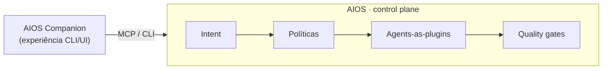

  

<h1 align="center">
  
   Olá, eu sou Kleilson Santos
</h1>

<h3 align="center">
  
</h3>

  
  
  
  
  
  

---

## Sobre

**Analista de Sistemas Sênior na CI&T.** Engenharia backend e full stack sênior: microsserviços Java, AppSec e DevSecOps, com IA aplicada e governança.

Mais de 9 anos em sistemas do setor financeiro: microsserviços event-driven, Apache Kafka e AppSec. Autor do [AIOS](https://github.com/KleilsonSantos/ai-operating-system), plataforma open source de governança de IA no SDLC.

- 📍 Paulo Afonso, Bahia, Brasil · Remoto · Tempo integral
- ☕ Backend com **Java 21**, **Spring Boot 4.x** e **Apache Kafka**, em arquitetura hexagonal (Saga, DLQ e idempotência)
- 🔐 **AppSec e DevSecOps**: Mend (SCA), Fortify (SAST), SonarQube e OWASP Dependency-Check
- 🖥️ Full stack com Angular, React e TypeScript
- 🤖 IA aplicada: GitHub Copilot, Spec-Driven Development (SDD) e agentes customizados
- 🏅 Certificação Microsoft Azure AI Fundamentals (AI-900)

> Conteúdo alinhado ao [portfólio](https://kleilson-portfolio.pages.dev).

---

## Destaques

- **50%** de redução em vulnerabilidades com Mend (SCA) e Fortify (SAST)
- **20+ APIs RESTful** em Spring Boot com arquitetura hexagonal
- **≥ 80%** de cobertura de testes JaCoCo com JUnit 5 e Testcontainers
- Migração **Spring Boot 2→3→4** sem downtime, com eliminação das APIs depreciadas
- **GitOps** end-to-end com ArgoCD, Gitea e k3d
- **SDD** aplicado com 10 agentes Copilot, 7 prompts e 6 `applyTo`

---

## Projetos

### Em destaque

| Projeto | Descrição | Stack |
|---------|-----------|-------|
| 🧠 [AIOS](https://github.com/KleilsonSantos/ai-operating-system) | AI Operating System: control plane de governança de IA no SDLC (intent → políticas → agents-as-plugins → quality gates) | MCP, TypeScript, Turborepo, React, Vitest |
| 🔐 [VaultSpring](https://github.com/KleilsonSantos/VaultSpring) | Serviço Spring Boot de credenciais seguras, com segredos no HashiCorp Vault, autenticação JWT/RBAC e CI DevSecOps | Spring Boot, Vault, PostgreSQL, Flyway, Testcontainers |
| ☁️ [cloud-event-lab](https://github.com/KleilsonSantos/cloud-event-lab) | Lab de eventos cloud-native multi-cloud, com profiles local, AWS, Azure e GCP validados em emuladores (não é produção em cloud real) | Java 21, Spring Boot, OpenTelemetry, React, Kubernetes |

#### AIOS: fluxo de governança

<strong>Outros projetos (6)</strong>

| Projeto | Descrição | Stack |
|---------|-----------|-------|
| 💬 [AIOS Companion](https://github.com/KleilsonSantos/aios-companion) | Experiência CLI/UI sobre o AIOS via MCP (Conversation Manager, doctor e auditoria) | TypeScript, React 19, Vite, MCP |
| 📊 [infra-devtools](https://github.com/KleilsonSantos/infra-devtools) | Stack DevSecOps para times, com automação via Makefile | Docker, SonarQube, Prometheus, Grafana, OWASP |
| 🌐 [kleilson-portfolio](https://github.com/KleilsonSantos/kleilson-portfolio) | Código-fonte do [portfólio](https://kleilson-portfolio.pages.dev) | React, TypeScript, Vite, Cloudflare |
| ⚙️ [Mongo-RestFull-API](https://github.com/KleilsonSantos/Mongo-RestFull-API) | API REST com CRUD, autenticação JWT e middlewares de segurança | Node.js, Express, TypeScript, MongoDB |
| 🛡️ [appsec-daily-hub](https://github.com/KleilsonSantos/appsec-daily-hub) | Hub de conteúdo AppSec: vulnerabilidades críticas, ferramentas OWASP e tutoriais | HTML, OWASP |
| 🛒 [OrderProcessingSystem](https://github.com/KleilsonSantos/OrderProcessingSystem) | Processamento assíncrono de pedidos com foco em performance | Java, Spring Boot, Spring Batch, Redis |

---

## 📊 GitHub Summary Cards

  <picture>
    <source media="(prefers-color-scheme: dark)" srcset="https://github-profile-summary-cards.vercel.app/api/cards/profile-details?username=KleilsonSantos&theme=github_dark">
    <source media="(prefers-color-scheme: light)" srcset="https://github-profile-summary-cards.vercel.app/api/cards/profile-details?username=KleilsonSantos&theme=github">
    
  </picture>
  <picture>
    <source media="(prefers-color-scheme: dark)" srcset="https://github-profile-summary-cards.vercel.app/api/cards/stats?username=KleilsonSantos&theme=github_dark">
    <source media="(prefers-color-scheme: light)" srcset="https://github-profile-summary-cards.vercel.app/api/cards/stats?username=KleilsonSantos&theme=github">
    
  </picture>
  <picture>
    <source media="(prefers-color-scheme: dark)" srcset="https://github-profile-summary-cards.vercel.app/api/cards/productive-time?username=KleilsonSantos&theme=github_dark&utcOffset=-3">
    <source media="(prefers-color-scheme: light)" srcset="https://github-profile-summary-cards.vercel.app/api/cards/productive-time?username=KleilsonSantos&theme=github&utcOffset=-3">
    
  </picture>
  <picture>
    <source media="(prefers-color-scheme: dark)" srcset="https://github-profile-summary-cards.vercel.app/api/cards/repos-per-language?username=KleilsonSantos&theme=github_dark">
    <source media="(prefers-color-scheme: light)" srcset="https://github-profile-summary-cards.vercel.app/api/cards/repos-per-language?username=KleilsonSantos&theme=github">
    
  </picture>
  <picture>
    <source media="(prefers-color-scheme: dark)" srcset="https://github-profile-summary-cards.vercel.app/api/cards/most-commit-language?username=KleilsonSantos&theme=github_dark">
    <source media="(prefers-color-scheme: light)" srcset="https://github-profile-summary-cards.vercel.app/api/cards/most-commit-language?username=KleilsonSantos&theme=github">
    
  </picture>

## 📈 Estatísticas

  <picture>
    <source media="(prefers-color-scheme: dark)" srcset="https://github-stats-extended.vercel.app/api?username=KleilsonSantos&show_icons=true&theme=dark_github&count_private=true">
    <source media="(prefers-color-scheme: light)" srcset="https://github-stats-extended.vercel.app/api?username=KleilsonSantos&show_icons=true&theme=light_github&count_private=true">
    
  </picture>
  <picture>
    <source media="(prefers-color-scheme: dark)" srcset="https://streak-stats.demolab.com/?user=KleilsonSantos&theme=dark">
    <source media="(prefers-color-scheme: light)" srcset="https://streak-stats.demolab.com/?user=KleilsonSantos&theme=default">
    
  </picture>

---

## 🛠️ Competências

### ☕ Backend & Arquitetura

  
  
  
  
  
  

### ☁️ DevSecOps & Cloud

  
  
  
  
  
  
  
  

### 🤖 AI Applied Engineering

  
  
  
  
  
  
  

### 🌐 Frontend

  
  
  
  
  
  

### 🗃️ Dados & Observabilidade

  
  
  
  
  
  

